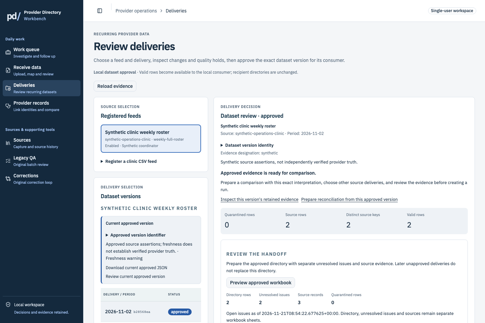

# Provider Directory Workbench

A local web application for cleaning provider rosters, comparing directory sources, and producing approved datasets with traceable evidence.

An analyst receives a clinic workbook and a later CSV that changes one office while omitting another. The workbench preserves the originals, applies reviewed cleaning rules, holds incomplete deliveries, and keeps the last approved dataset available to downstream users. Conflicting directory evidence can become a scoped investigation with a recorded decision history.

**Python · FastAPI · React · TypeScript · shadcn/ui · Tailwind · SQLite**

## Adaptive intake and review

The workbench includes scoped reuse of approved mapping recipes, structural drift and ambiguity reports, optional approved-example context for model proposals, and an approved-directory review workbook with unresolved issues and source references. Licensing-source integration, expanded identity investigation and network analytics follow through explicit spec revisions.

**Contributors start with [NEXT](NEXT.md)**, then the [S1 contract](docs/ADAPTIVE_INGESTION_SPEC.md), [ROADMAP](ROADMAP.md) and [STATUS](STATUS.md). The ingestion-first plan supersedes the earlier immediate recipient-response priority. The application remains one modular system; separate packages/apps are future evidence-driven extraction decisions.

## What works

| Area | Implemented behavior |
|---|---|
| Intake | CSV/XLSX, declared JSON formats, NPPES/CMS lookups, saved FHIR R4 Bundles and bounded payer-directory capture |
| Cleaning | Column profiling, versioned mapping/normalization recipes, duplicate checks, quarantine and explicit acceptance |
| Data management | Recurring clinic feeds, quality holds, approved versions and an independent version-pinned contact reader |
| Review | Separate clinician/location links, field-level provenance, conflicting evidence, follow-up and investigation history |
| Recovery | Repeat/restart handling, stale-write rejection and stopped database-plus-artifact backup/restore |
| Optional assistance | MCP inspection/proposals and an experimental model-backed mapping client; actual-model evaluation remains open |

The FHIR consumer targets a documented **R4 4.0.1 / Plan-Net 1.2.0 subset**. Unsupported resources and ambiguous relationships stay visible. It does not implement a conformant FHIR server or payer writeback.



## Run the web workbench

Requires Python 3.10+ and Node 22.12+; the automated environment uses Python 3.13 and Node 22.

```sh
git clone https://github.com/mlow-io/provider-data-workbench.git
cd provider-data-workbench
python3 -m venv .venv
source .venv/bin/activate
python3 -m pip install -e '.[dev,mcp]'
npm ci --prefix web
make workbench
```

Open the printed local URL. The work queue is the entry point. In Receive data, load the synthetic clinic workbook, review the mapping and quarantine, then explicitly accept eligible rows. The launcher creates a fresh retained runtime; it prints the root to use when resuming.

[Demo and export inspection guide](docs/OPERATIONS_DEMO.md#run-and-inspect) · [Engineering case study](docs/CASE_STUDY.md) · [Current synthetic UI](docs/evidence/canonical/workbench-migration-2026-11-21/delivery-wide.png)

## Reproduce the complete workflow

After setup:

```sh
mkdir -p .runtime
provider-truth-layer rehearse-operations --root .runtime/operations-demo-NEW
```

Use a new suffix for each run. This creates synthetic workbook/CSV/FHIR inputs, exercises controlled loopback HTTP failures, holds an incomplete delivery, reads the pinned approved export, investigates NORTH while preserving SOUTH, and verifies restart/backup/restore. It retains JSON/XLSX exports and a report in the selected root. It makes no public payer or model calls.

The Python wheel and source distribution also include the headless commands and their immutable default assets. [Portable installation details](docs/OPERATIONS_DEMO.md#portable-python-installation) describe use outside a checkout. The web interface uses the source/Node setup above.

## Verification and scope

The 2026-11-15 checkpoint passed **869 Python tests**, **134 frontend tests**, **72 desktop/phone browser scenarios**, pipeline validation, a production build, and clean wheel/sdist installed journeys. [The verification record](docs/evidence/canonical/integrated-review-2026-11-15/README.md) includes failures/reruns, exact artifacts and limitations. CI repeats the required checks.

The local UI1 update passed 136 frontend tests and a production build; its [separate record](docs/evidence/canonical/operator-ui-2026-11-19/README.md) preserves the 74-scenario full browser pass, follow-up failures and corrected affected reruns. Adaptive response/enrollment/research extensions remain design contracts.

This is a single-user local application developed with agent-assisted implementation and human direction/review. Synthetic correctness and bounded live-source observations do not establish production accuracy, full standards conformance or measured customer benefit. Actual-model evaluation and uncoached analyst sessions remain open. Actor names, contact events and submissions are local assertions; the application sends no outreach or payer updates.

## Engineering documentation

[Operator workflow](docs/OPERATOR_EXPERIENCE.md) · [Provider operations contract](docs/PROVIDER_OPERATIONS_CONTRACT.md) · [Specification](SPEC.md) · [Architecture](docs/ARCHITECTURE.md) · [Roadmap](ROADMAP.md) · [Current status](STATUS.md) · [Spec-driven delivery](docs/SPEC_DRIVEN_DELIVERY.md)

[API reference](docs/API_REFERENCE.md) · [Data dictionary](docs/DATA_DICTIONARY.md) · [Design decisions](docs/DECISIONS.md) · [Read-only operational SQL](docs/OPERATIONAL_SQL.md) · [Contributor guide](AGENTS.md)

```sh
make validate
npm test --prefix web
npm run build --prefix web
npm run test:e2e --prefix web
python3 scripts/check_project_docs.py
python3 scripts/sync_bundled_assets.py
```

Tests use owned disposable storage. [Operator procedures](docs/operations_governance/sop_provider_remediation.md) cover stopped backup/restore. Private preparation, credentials and actual-source runtime data stay outside the repository.

The component-system migration adds a responsive sidebar, delivery table/inspector, evidence tabs and shared intake/mapping/reconciliation controls. Major workspaces load on demand. The [migration record](docs/evidence/canonical/workbench-migration-2026-11-21/README.md) retains frontend/build/browser checks, inspected synthetic captures and remaining performance/supporting-surface limits.

The [UI qualification protocol](docs/UI_QUALIFICATION.md) includes a reproducible production-build benchmark at 100 and 1,000 synthetic records, bounded previews and complete workbook inspection. [The results and flows](docs/evidence/canonical/ui-qualification-2026-11-21/README.md) retain raw metrics, captures and limits.

## Reviewed correction workflow

Review exact clinician/office identity links and select a phone assertion in Reconciliation. Open the current approved delivery, inspect reviewed phone decisions, compare the number and extension, and create a complete roster candidate. Approve that candidate separately before preparing its pinned JSON/XLSX handoff. Original source bytes and earlier approved versions remain available; corrected rows include decision/source lineage. See [S1.3](docs/FIELD_MATERIALIZATION_SPEC.md), [the operator flow](docs/OPERATOR_EXPERIENCE.md#reviewed-correction-to-handoff) and [review export format 2](docs/REVIEW_WORKBOOK_CONTRACT.md).
