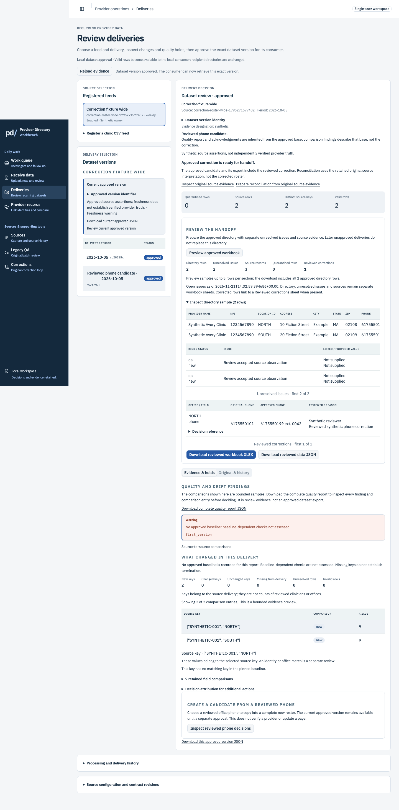

# Provider Directory Workbench

A local application for importing inconsistent provider files, reviewing office discrepancies, and exporting approved datasets with traceable evidence.

An operator receives a clinic workbook and a later delivery that changes one office while omitting another. The workbench retains originals, applies reviewed cleaning rules, holds incomplete data and keeps the last approved version usable. A reviewed phone can become a new roster candidate; approval remains a separate action.

**Python · FastAPI · React · TypeScript · shadcn/ui · Tailwind · SQLite**

## What it does

| Area | Implemented behavior |
|---|---|
| Intake | CSV/XLSX, declared JSON profiles, bounded NPPES/CMS lookups, saved FHIR directory Bundles and fixed-source capture |
| Cleaning | Column profiling, reviewed normalization recipes, compatibility/drift reports, quarantine and explicit acceptance |
| Review | Separate clinician/office links, conflicting source assertions, local field decisions and investigation history |
| Delivery | Recurring feeds, quality holds, separately approved phone corrections and version-pinned consumer output |
| Exports | Complete approved JSON/XLSX, extensions, correction/source lineage and separate complete quality evidence for review |
| Recovery | Retained versions/artifacts, stale-write checks, retry/restart and stopped database-plus-artifact recovery |
| Optional assistance | MCP/model mapping proposals through normal review; manual operation works without model access |

The application is single-user and local. FHIR support is a documented **R4 4.0.1 / Plan-Net 1.2.0 subset**, not a conformant server. Licensing-board integration, expanded network analysis, recipient exchange and hosting are future work. Local approval is not independent provider verification or payer writeback.



## Run it

Use Python 3.10+ and Node 22.12+ within 22.x; [web/package.json](web/package.json) lists other allowed Node versions. CI uses Python 3.13 and Node 22.

```sh
git clone https://github.com/mlow-io/provider-data-workbench.git
cd provider-data-workbench
python3 -m venv .venv
source .venv/bin/activate
python3 -m pip install -e '.[dev,mcp]'
npm ci --prefix web
make workbench
```

Open the printed local URL. The launcher prints an invocation-owned demo root and its `inputs` directory, including the synthetic clinic workbook/CSV. Start in Receive data to inspect a file, map its columns and separately accept valid rows. Storage is retained; resume with `python3 scripts/demo.py --root <existing-demo-root>`. The work queue is the default entry point.

For a headless connected rehearsal after setup:

```sh
mkdir -p .runtime
provider-truth-layer rehearse-operations --root .runtime/operations-demo-NEW
```

Choose a new root. The rehearsal uses synthetic files and controlled loopback HTTP, preserves the last approved roster while a delivery is held, inspects exports and exercises restart/backup/restore. It makes no public payer or model calls. See [run/export inspection](docs/OPERATIONS_DEMO.md#run-and-inspect) and [portable Python installation](docs/OPERATIONS_DEMO.md#portable-python-installation); the web interface requires the source/Node setup above.

## Correction and handoff

Review clinician/office links and select a source phone in Reconciliation. Open the current approved delivery, inspect reviewed phone decisions, compare number/extension/source, and create a candidate. Review its complete quality evidence and approve it separately. Then preview/download approved JSON or XLSX. Earlier versions and original bytes remain readable. See [the operator flow](docs/OPERATOR_EXPERIENCE.md#reviewed-correction-to-handoff) and [correction contract](docs/FIELD_MATERIALIZATION_SPEC.md).

## Verification and limits

[STATUS](STATUS.md) is the current implementation/checkpoint summary; [dated receipts](docs/evidence/canonical/README.md) retain exact builds, commands, failures and limits. [CI](https://github.com/mlow-io/provider-data-workbench/actions) runs the required checks. The [UI protocol](docs/UI_QUALIFICATION.md) records production-build measurements at 100/1,000 records; samples do not truncate complete exports.

[The independent mapping challenge](docs/AI_MAPPING_EVALUATION.md) is one blinded external-agent observation against frozen synthetic expectations. Saved-proposal replay runs without model access. Neither that challenge nor controlled transport tests establish production-model quality, broad injection resistance or human time savings. Owner visual acceptance, uncoached-user outcomes and broader source conformance remain open.

## Contribute

Start with [AGENTS](AGENTS.md), [NEXT](NEXT.md) and [STATUS](STATUS.md), then the relevant contract. [SPEC](SPEC.md) owns product behavior, [architecture](docs/ARCHITECTURE.md) service boundaries, and [ROADMAP](ROADMAP.md) future scope.

[API reference](docs/API_REFERENCE.md) · [Data dictionary](docs/DATA_DICTIONARY.md) · [Operator procedures](docs/operations_governance/sop_provider_remediation.md) · [Design decisions](docs/DECISIONS.md)

```sh
make validate
npm test --prefix web
npm run build --prefix web
npm run test:e2e --prefix web
python3 scripts/check_project_docs.py
```

Use invocation-owned synthetic storage and reuse warm dependencies. Credentials, actual-source runtime data and private preparation stay outside Git. [AGENTS](AGENTS.md) defines checks and publication boundaries; a passing link checker does not prove documentation accuracy.
