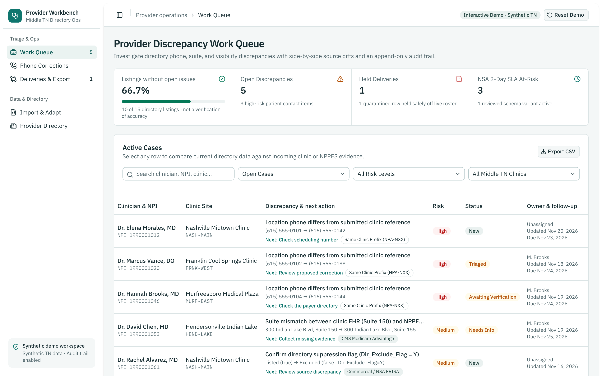
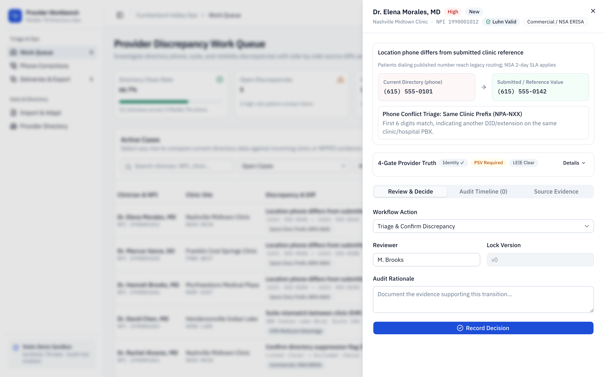
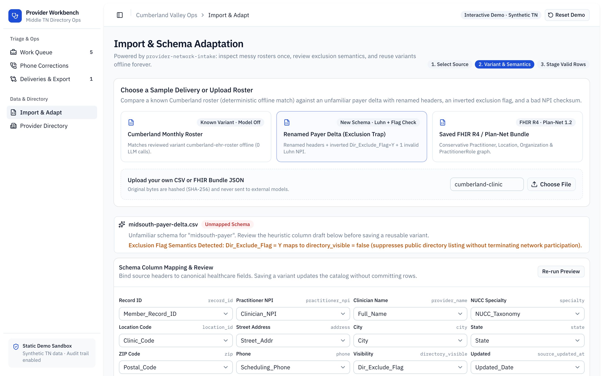
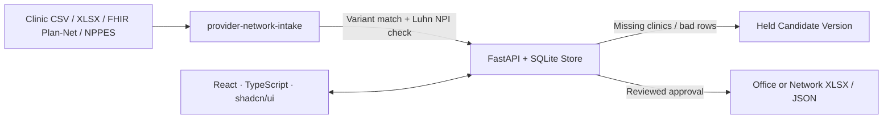

# Provider Data Workbench

**A healthcare provider-directory operations console for catching ghost-network regressions, adapting messy clinic rosters, and exporting audit-ready directories.**

**[Launch Live Interactive Browser Demo](https://mlow-io.github.io/provider-data-workbench/)** *(runs 100% client-side in your browser using the synthetic Middle Tennessee showcase—no Python or database setup required)*

Payers and medical groups face strict **No Surprises Act** directory timelines (90-day verification, 2-business-day updates), yet routine roster spreadsheets frequently drop active clinics, invert directory exclusion flags (`Dir_Exclude_Flag = Y`), or disagree with NPPES/payer records on scheduling phone numbers.

Provider Data Workbench combines a deterministic Python/FastAPI/SQLite operations backend, the [`provider-network-intake`](https://github.com/mlow-io/provider-network-intake) schema-adaptation library, and a clean React + shadcn/ui workstation.



## Why it matters in healthcare operations

- **Prevents silent ghost networks:** Recurring deliveries that omit an active office (such as Franklin Cool Springs Clinic in a partial EHR extract) are held automatically while the last approved directory version stays live for consumers.
- **Separates schema review from operational approval:** Powered by [`provider-network-intake`](https://github.com/mlow-io/provider-network-intake), analysts (or proposal-only AI/MCP tools) review renamed headers and inverted boolean flags once, then replay every future delivery deterministically with zero LLM calls.
- **Reviewed corrections become approved data, not just notes:** When the clinic roster and a payer directory disagree on an office phone, an operator picks the value, the workbench builds a complete candidate roster that changes only that office's row, and a separate approval promotes it with pinned lineage. A clinician's other offices are never touched, and NPI alone never selects an office.
- **Visual field-level triage & append-only audit trail:** Operators inspect exact before/after diffs (`Clinic Roster` vs `NPPES` / `Payer`), record outreach and corrections under optimistic concurrency, and export snapshot-pinned XLSX/JSON rosters scoped to an entire network or a single clinic.
- **CMS NPI check-digit validation & bounded FHIR/NPPES support:** Validates 10-digit NPIs with the CMS ISO 7812 Luhn algorithm (`80840` prefix) and conservatively interprets saved NPPES API 2.1 and FHIR R4 / Plan-Net 1.2.0 Bundles.
- **Real-world domain signals & 4-Gate Provider Truth:** Separates Commercial No Surprises Act, CMS Medicare Advantage, and Medicaid / TennCare MCO regimes; flags hospital-based taxonomies (`207P`, `2085R`, etc.) marked accepting new patients; classifies phone conflicts (`Toll-Free Centralized Desk` vs. `Same Clinic Prefix (NPA-NXX)`); and isolates self-reported licensure from primary-source board verification (`PSV Required`).

| Discrepancy Diff Inspector | Import & Schema Adaptation |
|---|---|
|  |  |

## Architecture



## Quickstart

### 1. Run the full local workbench (Python 3.11+ & Node 22+)

```sh
git clone https://github.com/mlow-io/provider-data-workbench.git
cd provider-data-workbench
python3 -m venv .venv
source .venv/bin/activate
python3 -m pip install -e '.[dev,intake]'
npm ci --prefix web
make workbench
```

Open the printed local URL (`http://127.0.0.1:5173/`). Fresh demo workspaces launch pre-loaded with the synthetic **Cumberland Valley Medical Group** Middle Tennessee dataset (12 clinicians, 5 clinics, 5 active discrepancies, 1 verified correction, and 1 held partial feed).

### 2. Run the standalone interactive browser demo (no Python backend)

```sh
npm ci --prefix web
npm run build:demo --prefix web
npx --prefix web vite preview --outDir dist-demo
```

The static build runs an interactive in-memory replica of the Middle Tennessee showcase suitable for GitHub Pages or Vercel previews.

### 3. Headless pipeline validation & rehearsal

```sh
make validate
mkdir -p .runtime
provider-truth-layer rehearse-operations --root .runtime/rehearsal-1
```

## Documentation

- [Architecture](docs/ARCHITECTURE.md) — System boundaries and `provider-network-intake` integration
- [Data Model](docs/DATA_MODEL.md) — Clinician/office/network separation, SQLite triggers, and quarantine rules
- [Healthcare Standards](docs/FHIR_AND_STANDARDS.md) — No Surprises Act SLAs, FHIR R4 / Plan-Net 1.2 subset, CMS NPI Luhn checks, and AI boundaries
- [API Reference](docs/API_REFERENCE.md) — REST endpoints and concurrency guards
- [3-Minute Demo Walkthrough](docs/DEMO_WALKTHROUGH.md) — Guided click-through of all five operator views

## Scope & non-goals

This is a single-user local engineering showcase using strictly synthetic records (`1990001xxx` Luhn-valid synthetic NPIs, `(615) 555-01xx` reserved numbers). It does not connect to live payer clearinghouses, certify state licensure/CAQH credentialing, or execute full HL7 FHIR terminology servers without external validation attachments.
