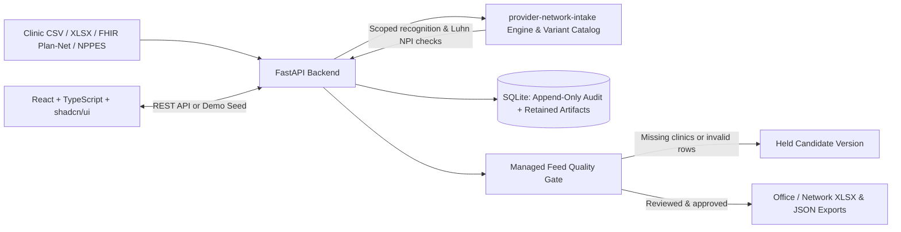

# Architecture

Provider Data Workbench connects a deterministic Python ingestion/reconciliation engine with an operator-facing React + shadcn/ui workstation and embeds [`provider-network-intake`](https://github.com/mlow-io/provider-network-intake) for reusable schema-variant governance.

## Module boundaries

| Layer | Location | Responsibility |
|---|---|---|
| Schema adaptation plugin | `provider-network-intake` (`CatalogStore`, `Engine`, MCP server) | Header/encoding inspection, CMS ISO 7812 NPI Luhn check-digit validation, source-scoped variant catalog, proposal-only AI/MCP integration |
| Durable intake & work queue | `src/provider_directory_truth_layer/intake_store.py` | Content-addressed artifact retention, quarantine isolation, optimistic-concurrency case transitions, append-only `work_event` trail |
| Managed feed & exports | `src/provider_directory_truth_layer/managed_feed.py`, `review_workbook.py` | Recurring roster versions, soft/hard quality holds, pinned approved snapshot, office-scoped XLSX/JSON exports |
| Workbench read models | `src/provider_directory_truth_layer/workbench_routes.py` | Operator KPIs (`/api/workbench/overview`), deduplicated clinician-location directory (`/api/workbench/directory`), schema-catalog status |
| Operator UI | `web/src/` | Pure Tailwind v4 + shadcn/ui workspace (`Work Queue`, `Import & Adapt`, `Deliveries & Export`, `Provider Directory`) plus standalone client-side demo mode |

## Core design guarantees

1. **Originals are never overwritten.** Every uploaded roster is hashed (`SHA-256`) and stored content-addressed under `<root>/artifacts/` before parsing or mapping begins.
2. **Schema review is isolated from operational approval.** Saving a reviewed variant in `provider-network-intake` teaches the catalog what `Dir_Exclude_Flag = Y` means without automatically accepting rows into the directory.
3. **Partial deliveries never silently drop active offices.** If an incoming weekly or monthly roster omits a clinic site present in the approved baseline (for example `FRNK-WEST`), the candidate version is held with `missing_keys` and `row_count_drift` while the last approved baseline remains active for downstream consumers.
4. **Optimistic concurrency prevents lost edits.** Case decisions (`expected_version`), feed approvals (`expected_report`, `expected_current`), and exports (`expected_snapshot`) reject stale reads with `409 Conflict`.
