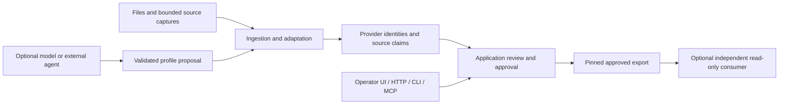
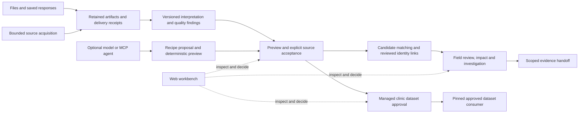

# Architecture and integration boundaries

The application runs locally as one Python/FastAPI backend, a React/TypeScript client, SQLite and a retained artifact store. This document maps the implemented responsibilities and the decisions that keep provider identity, office scope and approval history distinct. [SPEC](../SPEC.md) owns product behavior; [STATUS](../STATUS.md) records verification; [the delivery plan](SPEC_DRIVEN_DELIVERY.md) maps acceptance cases to evidence.

## Selected separation architecture

Selected 2026-11-21: evolve a **modular monolith**, one application with explicit responsibility boundaries, one SQLite database and one retained artifact store. These are logical ownership rules, not a claim that all existing files already follow new package boundaries. The [S1 draft](ADAPTIVE_INGESTION_SPEC.md) defines the next contract; P0 maps existing code and refactors only where the selected slice requires it.

| Module | Owns | Provides | Must not do |
|---|---|---|---|
| Ingestion and adaptation | Source acquisition, original artifacts/receipts, native parsing, compatibility reports, profile/recipe revisions and interpretation attempts | Version-pinned typed observations with locators, source scope and findings | Approve domain identity, invent missing facts, promote datasets or execute generated code |
| Provider-domain reconciliation | Clinician/organization/office identities, reviewed links, field claims, conflicts, and later license/network relationship semantics | Review candidates, scoped decisions and reconciliation outcomes | Assume an NPI is an office; infer network participation from unrelated evidence; alter source originals |
| Application and review | Use-case orchestration, approval transactions, investigation workflow, selected export snapshots and HTTP/CLI/MCP interfaces | Operator actions, approved-version readers and traceable exports | Reimplement business rules in React, conflate workflow decisions or bypass domain/version checks |
| Infrastructure | SQLite transaction/migration mechanics, retained-file IO, bounded HTTP/model transport, job execution and logging | Injected storage/transport facilities for existing services | Become a second authority for provider truth or a generic workflow platform |
| UI and optional consumers | Navigation, display, drafts, query state and approved-data presentation | Readable tasks and submitted commands | Mutate canonical data directly or interpret a failed fetch as an empty dataset |

Dependency direction: UI/HTTP/CLI/MCP → application use cases → ingestion/domain services → explicitly passed infrastructure. Pure parsing and normalization have no UI dependency or hidden network calls. Avoid cyclic service calls. Shared record references and contract types are small explicit interfaces, not an unrestricted shared utility module. Application use cases own transactions spanning affected modules; do not split existing atomic acceptance/promotion into independent commits merely to mimic services.

Keep acquisition, syntax and source meaning distinct. A source-profile registry describes known semantics and versions; recipes describe approved interpretation. Reuse OnboardingService/normalization recipes/MappingAssistant rather than introducing competing mapping stores. Map proposed fields and ownership to existing relations before adding tables. Preserve the native observation model even when a contact-review projection uses a flat table.

### Conditions for future extraction

- Extract ingestion as a versioned Python library only when a second real consumer needs it and its IO/error/schema contracts can be tested independently. Keep healthcare-specific meaning explicit rather than claiming universal ingestion.
- A public provider/network explorer is a natural separate frontend/app when it consumes approved exports or a read-only API. Establish audience, isolation, refresh and stale-version behavior before hosting it.
- Separate backend services/repositories only for an actual independent deployment, workload or ownership need. Account for release compatibility, network failure, authentication and distributed transactions first.
- Revisit PostgreSQL, object storage or a queue after measured concurrency/durability/deployment requirements justify them. Preserve migration, historical replay and backup recovery contracts.

No extraction is required for S1. Distinct modules and clear interfaces provide the learning and maintainability benefit now. [ROADMAP](../ROADMAP.md) schedules S5 architecture review when a consumer or deployment requirement exists.

## System shape

HTTP, CLI and MCP entrypoints call shared services. Validation and approval rules live in those services so every entrypoint enforces the same decisions.

These responsibilities run in the same backend. Managed-feed source acceptance and dataset promotion share one transaction. Reference-source acceptance retains directory evidence without promoting a clinic dataset.

Comparison can inspect retained preview or quarantined evidence with its findings; it does not require treating that evidence as accepted operational data. The Review box represents those separate inspection and acceptance responsibilities.

## Shared contracts

| Boundary | Producer → consumer | Stable information and invariants |
|---|---|---|
| C1 Delivery | Upload/fetch → artifact and intake services | Exact bytes/hash; source namespace; transport provenance; delivery identity; declared scope; retrieval time and coverage. Equal bytes do not mean the same delivery or provider. |
| C2 Interpretation | Parser/profile → preview and acceptance | Input receipt/artifact; immutable attempt and parser/configuration version; native locators; original values; derived values; typed findings. Readable input may still be unusable evidence. |
| C3 Comparison | Retained interpretation → reconciliation | Exact attempt and resource/row/address references; entity kind; per-field source references; relationship context; usable/unresolved status. FHIR composition must preserve every contributing resource. |
| C4 Decisions | Web/CLI service request → transactional store | Expected current version/snapshot; actor/reason; separate proposal, acceptance, link, field and dataset decisions. Stale writes change neither projection nor history. |
| C5 Consumer | Approved feed version → downstream reader | Explicit immutable version, contract revision, dataset schema, source lineage, approval and completeness context. A held candidate cannot replace the current approved pointer. |
| C6 Assistance | Bounded source sample → model → proposal service | Run identity, exact input context, model/prompt/schema versions, bounded output, deterministic validation and review disposition. A model result has no approval authority. |

Wire fields and schema migrations are documented in the implemented [API reference](API_REFERENCE.md) and [data dictionary](DATA_DICTIONARY.md).

## Code ownership by responsibility

| Area | Existing entrypoints | Responsibility and change boundary |
|---|---|---|
| Acquisition and native parsing | `intake_adapters.py`, `fhir_intake.py`, `fhir_json.py`, `fhir_store.py`, `fhir_acquisition.py`, `fhir_acquisition_api.py` | Implemented pure parser, native ledger integration and bounded durable acquisition; raw response origins remain distinct from assembled locators |
| Cleaning and onboarding | `interpretation.py`, `normalization_recipes.py`, `onboarding_service.py` | Preserve clinic validation; give native resources their own validation/projection boundary; D3 reuses recipes |
| Source evidence and comparison | `comparison_inputs.py`, `reconciliation_store.py`, `identity_review.py` | D1 resource relationships and multi-resource field lineage; preserve reviewed clinician/location separation |
| Field review and investigation | `field_reconciliation.py`, `change_impact.py`, `follow_up.py`, `work_export.py` | Carry new supporting references through selected evidence, freshness checks and exports |
| Managed data | `managed_feed.py`, `feed_api.py`, `feed_worker.py` | Reuse existing clinic approvals and immutable consumer versions; do not convert bounded FHIR evidence into a full roster |
| Agent entrypoint | `mcp_server.py`, `onboarding_service.py`, `mapping_model.py`, `mapping_assistant.py`, `mapping_evaluation.py` | One optional bounded invocation and retained run ledger return only proposed recipes into existing review; frozen evaluation distinguishes actual trials from controlled transport |
| Operator UI | `IntakeWorkbench.tsx`, `NativeEvidencePanel.tsx`, `FhirAcquisitionPanel.tsx`, `NormalizationPanel.tsx`, `MappingAssistantPanel.tsx`, `ReconciliationWorkspace.tsx`, `ManagedFeeds.tsx`, `workspaceNavigation.ts` | Source/version context, findings, actionable next steps and visible failure/stale states across each slice |

Python module names are relative to `src/provider_directory_truth_layer`; UI modules to `web/src`. The table identifies the service boundaries used for changes and review.

## Consequential design choices

1. **Separate resource validation from clinic-row validation.** Location and Organization resources can be useful reference evidence without the NPI/phone/address combination required by clinic rows. Native acceptance has its own policy and does not create clinic work automatically.
2. **Retain multi-resource lineage.** A FHIR comparison can combine a Practitioner name, Location phone and PractitionerRole context. Every projected field carries contributing resource paths through review and export.
3. **Preserve selected scope and shared context.** A complete Bundle may contain both offices. A NORTH handoff labels shared originals while keeping selected operational evidence scoped to NORTH.
4. **Separate source relationships from reviewed bindings.** A source Network resource is retained evidence; a local network binding is a distinct reviewed identity. NPI identifies a provider, not an office or global network membership.
5. **Pin decisions to versions.** A receipt's latest interpretation is separate from an approved dataset version. Expected-version checks and transactions reject stale actions; held candidates preserve the previous consumer version.

## Proportionate refactoring and growth

Extract pure parsing/projection code and affected UI sections where a slice needs them. Keep compatibility tests at service boundaries. Do not combine a broad component rewrite with new domain semantics. The larger Intake/Reconciliation components are refactoring candidates when touched, not a separate rewrite milestone.

Revisit SQLite/local workers when measured workload, concurrent-user requirements or deployment needs exceed this design. Revisit scraping or extra transports for a named coverage gap. Revisit a FHIR server/export only when a consumer needs it. Record those decisions in [DECISIONS](DECISIONS.md), with evidence and consequences.

## Planned research and exchange boundary

The proposed [provider research/exchange contract](PROVIDER_RESEARCH_EXCHANGE.md) adds external response correlation, source-native enrollment relationships and finite case research around the existing services. It is not implemented. Research result schemas differ from column-mapping runs; reuse execution/retention patterns without overloading their semantics. Source registration remains an explicit reviewed dispatcher with per-source validation, not arbitrary URL tools. Parent research budgets aggregate all task/model/network attempts. Existing reviewed identities and source observations remain authoritative; no second canonical entity graph is introduced.

The initial slice uses a minimal exchange manifest generated from a pinned approved export before response parsing. A later recipient-template exporter consumes that same manifest and source/decision versions. Additive SQL relations, indexes, constraints and migration numbers are frozen per slice rather than executing a speculative schema up front.

The selected [UI contract](OPERATOR_EXPERIENCE.md) reuses workspace URL/action guards and shared services. Primary navigation exposes delivered tasks only; typed comparisons precede original JSON disclosure. Read-only operational measures use the same SQLite snapshot and defined populations under [their own contract](OPERATIONAL_MEASURES.md), rather than mutable UI counters or a separate reporting store.
