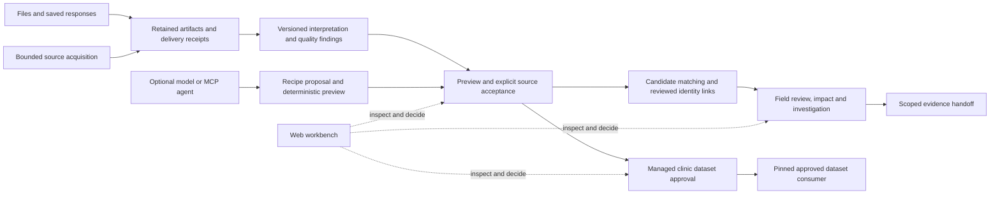

# Architecture and integration boundaries

The application runs locally as one Python/FastAPI backend, a React/TypeScript client, SQLite and a retained artifact store. This document maps the implemented responsibilities and the decisions that keep provider identity, office scope and approval history distinct. [SPEC](../SPEC.md) owns product behavior; [STATUS](../STATUS.md) records verification; [the delivery plan](SPEC_DRIVEN_DELIVERY.md) maps acceptance cases to evidence.

## System shape

HTTP, CLI and MCP entrypoints call shared services. Validation and approval rules live in those services so every entrypoint enforces the same decisions.

These responsibilities run in the same backend. Managed-feed source acceptance and dataset promotion share one transaction. Reference-source acceptance retains directory evidence without promoting a clinic dataset.

Comparison can inspect retained preview or quarantined evidence with its findings; it does not require treating that evidence as accepted operational data. The Review box represents those separate inspection and acceptance responsibilities.

## Shared contracts

| Boundary | Producer → consumer | Stable information and invariants |
|---|---|---|
| C1 Delivery | Upload/fetch → artifact and intake services | Exact bytes/hash; source namespace; transport provenance; delivery identity; declared scope; retrieval time and coverage. Equal bytes do not mean the same delivery or provider. |
| C2 Interpretation | Parser/profile → preview and acceptance | Input receipt/artifact; immutable attempt and parser/configuration version; native locators; original values; derived values; typed findings. Readable input may still be unusable evidence. |
| C3 Comparison | Retained interpretation → reconciliation | Exact attempt and resource/row/address references; entity kind; per-field source references; relationship context; usable/unresolved status. FHIR composition must preserve every contributing resource. |
| C4 Decisions | Web/CLI service request → transactional store | Expected current version/snapshot; actor/reason; separate proposal, acceptance, link, field and dataset decisions. Stale writes change neither projection nor history. |
| C5 Consumer | Approved feed version → downstream reader | Explicit immutable version, contract revision, dataset schema, source lineage, approval and completeness context. A held candidate cannot replace the current approved pointer. |
| C6 Assistance | Bounded source sample → model → proposal service | Run identity, exact input context, model/prompt/schema versions, bounded output, deterministic validation and review disposition. A model result has no approval authority. |

Wire fields and schema migrations are documented in the implemented [API reference](API_REFERENCE.md) and [data dictionary](DATA_DICTIONARY.md).

## Code ownership by responsibility

| Area | Existing entrypoints | Responsibility and change boundary |
|---|---|---|
| Acquisition and native parsing | `intake_adapters.py`, `fhir_intake.py`, `fhir_json.py`, `fhir_store.py`, `fhir_acquisition.py`, `fhir_acquisition_api.py` | Implemented pure parser, native ledger integration and bounded durable acquisition; raw response origins remain distinct from assembled locators |
| Cleaning and onboarding | `interpretation.py`, `normalization_recipes.py`, `onboarding_service.py` | Preserve clinic validation; give native resources their own validation/projection boundary; D3 reuses recipes |
| Source evidence and comparison | `comparison_inputs.py`, `reconciliation_store.py`, `identity_review.py` | D1 resource relationships and multi-resource field lineage; preserve reviewed clinician/location separation |
| Field review and investigation | `field_reconciliation.py`, `change_impact.py`, `follow_up.py`, `work_export.py` | Carry new supporting references through selected evidence, freshness checks and exports |
| Managed data | `managed_feed.py`, `feed_api.py`, `feed_worker.py` | Reuse existing clinic approvals and immutable consumer versions; do not convert bounded FHIR evidence into a full roster |
| Agent entrypoint | `mcp_server.py`, `onboarding_service.py`, `mapping_model.py`, `mapping_assistant.py`, `mapping_evaluation.py` | One optional bounded invocation and retained run ledger return only proposed recipes into existing review; frozen evaluation distinguishes actual trials from controlled transport |
| Operator UI | `IntakeWorkbench.tsx`, `NativeEvidencePanel.tsx`, `FhirAcquisitionPanel.tsx`, `NormalizationPanel.tsx`, `MappingAssistantPanel.tsx`, `ReconciliationWorkspace.tsx`, `ManagedFeeds.tsx`, `workspaceNavigation.ts` | Source/version context, findings, actionable next steps and visible failure/stale states across each slice |

Python module names are relative to `src/provider_directory_truth_layer`; UI modules to `web/src`. The table identifies the service boundaries used for changes and review.

## Consequential design choices

1. **Separate resource validation from clinic-row validation.** Location and Organization resources can be useful reference evidence without the NPI/phone/address combination required by clinic rows. Native acceptance has its own policy and does not create clinic work automatically.
2. **Retain multi-resource lineage.** A FHIR comparison can combine a Practitioner name, Location phone and PractitionerRole context. Every projected field carries contributing resource paths through review and export.
3. **Preserve selected scope and shared context.** A complete Bundle may contain both offices. A NORTH handoff labels shared originals while keeping selected operational evidence scoped to NORTH.
4. **Separate source relationships from reviewed bindings.** A source Network resource is retained evidence; a local network binding is a distinct reviewed identity. NPI identifies a provider, not an office or global network membership.
5. **Pin decisions to versions.** A receipt's latest interpretation is separate from an approved dataset version. Expected-version checks and transactions reject stale actions; held candidates preserve the previous consumer version.

## Proportionate refactoring and growth

Extract pure parsing/projection code and affected UI sections where a slice needs them. Keep compatibility tests at service boundaries. Do not combine a broad component rewrite with new domain semantics. The larger Intake/Reconciliation components are refactoring candidates when touched, not a separate rewrite milestone.

Revisit SQLite/local workers when measured workload, concurrent-user requirements or deployment needs exceed this design. Revisit scraping or extra transports for a named coverage gap. Revisit a FHIR server/export only when a consumer needs it. Record those decisions in [DECISIONS](DECISIONS.md), with evidence and consequences.
